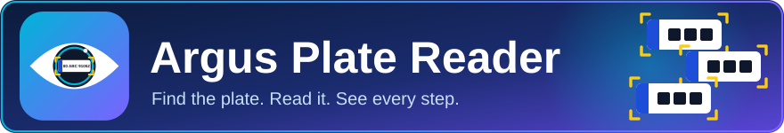
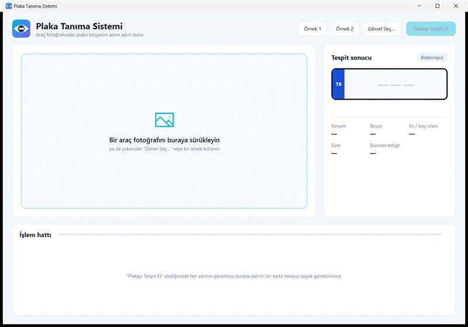
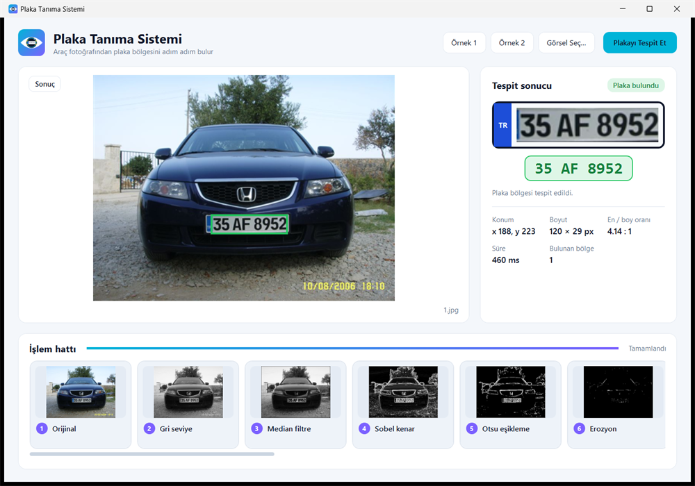
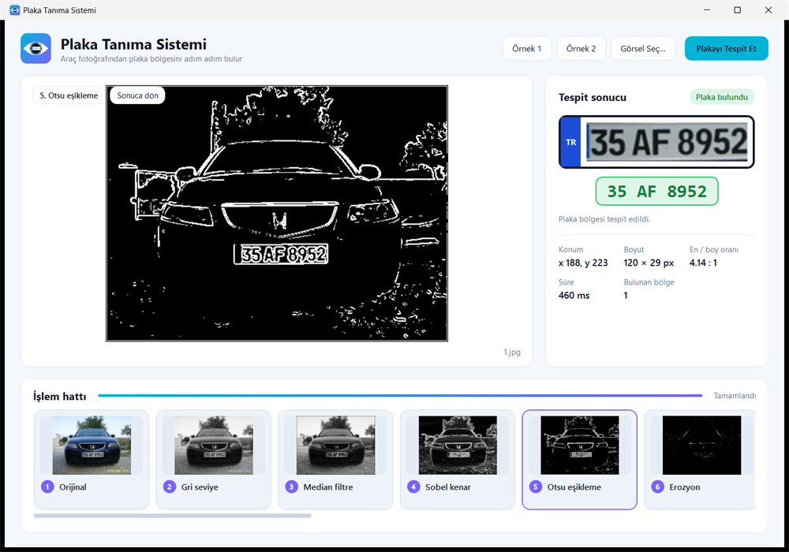
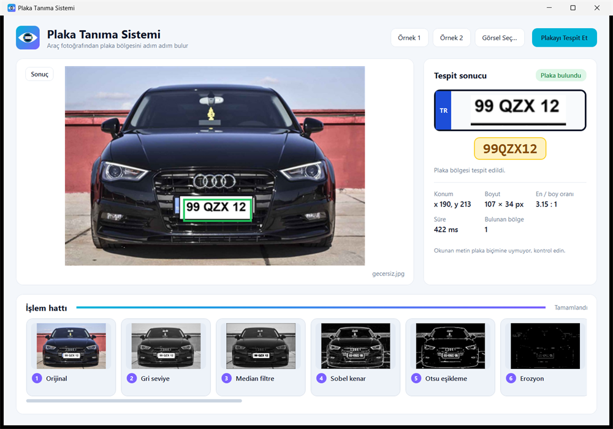
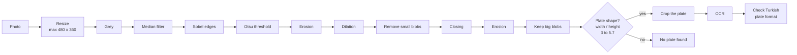
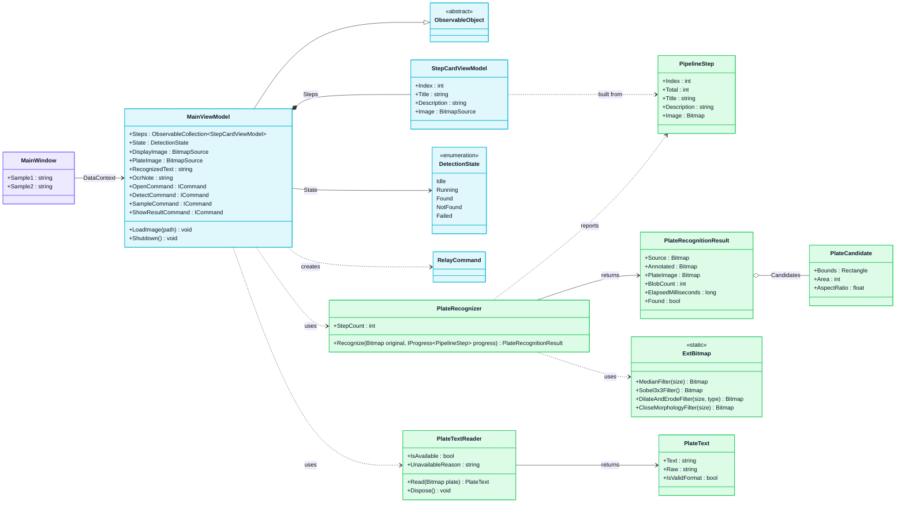
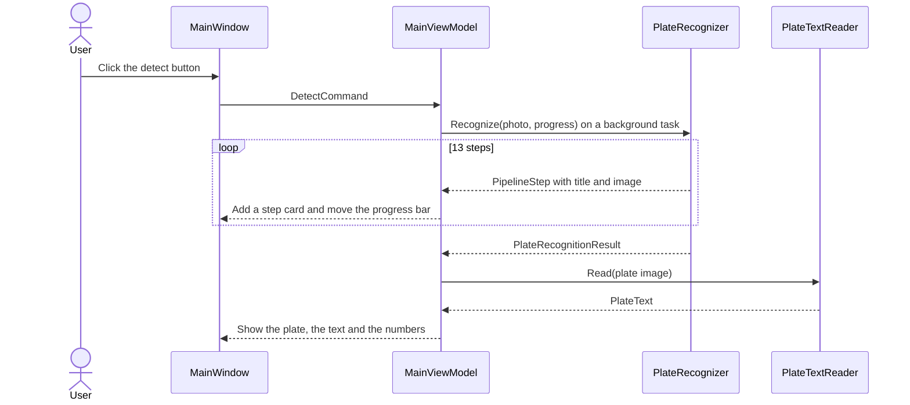

<p align="center">
  
</p>

<p align="center">🇬🇧 English · 🇹🇷 <a href="docs/README.tr.md">Türkçe</a></p>

<p align="center">
  <b>👁️ A WPF app that finds the licence plate in a car photo and reads it.</b><br>
  You can watch every step of the image processing, one by one.
</p>

<p align="center">
  <a href="https://github.com/NisanurBulut/LicensePlateRecognitionSystem/actions/workflows/build.yml"></a>
  <a href="https://github.com/NisanurBulut/LicensePlateRecognitionSystem/releases"></a>
  
  
  <a href="PlakaTanimaSistemi/COPYING.txt"></a>
</p>

<p align="center">
  ⭐ <b>Do you like Argus Plate Reader? Please give it a star!</b> ⭐<br>
  It is free and it only takes a second, but it helps me a lot.<br><br>
  <a href="https://github.com/NisanurBulut/LicensePlateRecognitionSystem"></a>
</p>

<p align="center">
  
</p>

Argus Plate Reader takes a photo of the front of a car and looks for the licence plate.
It cleans the picture step by step, finds the shape of the plate, crops it and reads the letters and numbers.
At the end it checks that the text looks like a Turkish plate, for example `35 AF 8952`.

You see everything on one screen: the photo with a green box, the cropped plate, the text, some numbers and a card for each processing step.

> [!NOTE]
> The texts in the app are in Turkish. For example, the main button is called *Plakayı Tespit Et* (Find the plate).

This is the new version (WPF / MVVM) of the plate recognition project. The first WinForms version is still in this repository, in the `legacy` folder.

## ✨ What can it do?

| | Feature |
|---|---|
| 🔍 | **Step-by-step view**: 13 small cards show the picture after each step. Click a card to see it big. A light moves over the photo while the app works. |
| 🟩 | **Plate on the photo**: a green box shows where the plate is. The cropped plate and the text are shown next to it. |
| 🔤 | **Plate text (OCR)**: the app reads the letters and numbers and checks the Turkish format: city code (01–81), 1–3 letters, 2–4 numbers. |
| 📊 | **Numbers**: position, size, shape ratio, time and the number of regions that were found. |
| 🎨 | **Clear colours**: green for "plate found", yellow for "please check the text" or "plate not found", red for an error. |
| 🖱️ | **Easy to use**: drag a photo into the window, or use the buttons. Two sample photos are included. |
| ⌨️ | **Command line**: open a photo directly with `PlakaTanima.exe photo.jpg`. |
| ⚡ | **Smooth**: the work runs in the background, so the window never freezes. |

## 🖼️ Screens

<table>
  <tr>
    <td align="center"><b>✅ Result</b><br></td>
    <td align="center"><b>🔍 One step, big</b><br></td>
    <td align="center"><b>⚠️ Please check</b><br></td>
  </tr>
</table>

## 🚀 Quick start

You need Windows and Visual Studio with **.NET Framework 4.8** support.

1. Open `PlakaTanimaSistemi/PlakaTanima.sln`.
2. `PlakaTanima.Wpf` is the startup project.
3. Press **F5**. Click **Örnek 1** (Sample 1), then **Plakayı Tespit Et** (Find the plate).

Or use a terminal:

```bash
dotnet build PlakaTanimaSistemi/PlakaTanima.sln --configuration Release
PlakaTanimaSistemi/PlakaTanima.Wpf/bin/Release/net48/PlakaTanima.exe PlakaTanimaSistemi/images/1.jpg
```

> [!IMPORTANT]
> The project is built for **x86 (32-bit)**, because the Otsu and Tesseract libraries are 32-bit.

### 🔤 Reading the text (OCR)

Finding the plate works without any extra file. To also **read** the text, the app needs one language file.
It is not stored in this repository, because it is big.

1. Download [`tesseract-ocr-3.01.eng.tar.gz`](https://storage.googleapis.com/google-code-archive-downloads/v2/code.google.com/tesseract-ocr/tesseract-ocr-3.01.eng.tar.gz) (about 4 MB).
2. Take out only `eng.traineddata`:

   ```bash
   tar -xzf tesseract-ocr-3.01.eng.tar.gz tesseract-ocr/tessdata/eng.traineddata
   ```

3. Copy it to `PlakaTanimaSistemi/PlakaTanima.Wpf/tessdata/eng.traineddata`.
4. Build again.

> [!WARNING]
> Use version **3.01**. The OCR engine in this project is Tesseract 3.01. A newer language file (3.04 or later) makes it crash.
> The engine also needs the *Visual C++ 2008 runtime* on the computer.

If the file is missing, the app still finds the plate and tells you that it cannot read the characters.

## 🤔 How does it find a plate?

The app first makes the photo smaller (at most 480 × 360), then it cleans it and looks for a bright shape that is about 3 to 5.7 times wider than it is high. That is the shape of a plate.



The [Turkish README](docs/README.tr.md) explains each step with pictures and code.

## 📐 Architecture

The code has three layers. `PlakaTanima.Core` has no window code, so it can be reused in another app.

| Layer | Colour | What does it do? |
|---|---|---|
| 🟪 **View** (`PlakaTanima.Wpf`: `MainWindow.xaml`, `App.xaml`) | purple | The screen: photo, result card, step cards, colours and animations. |
| 🟦 **ViewModel** (`PlakaTanima.Wpf/ViewModels`) | blue | The state of the screen and the commands. It starts the work in the background and fills the screen when the work is done. |
| 🟩 **Core** (`PlakaTanima.Core`) | green | `PlateRecognizer` finds the plate and `PlateTextReader` reads it. The image filters are in `ExtBitmap`. |



This is what happens when you click the main button:



## 📄 Report

This project also has a written report:

| | |
|---|---|
| **Document** | 📄 [Project report (PDF)](PlateRecognitionSystemReport.pdf) |

## 🏷️ Releases and versions

Work happens on branches. A branch reaches `master` with a **pull request** (a request to merge the branch).
When a pull request is merged, GitHub Actions makes a new **GitHub release** with a version number like `v1.2.3`.
The first version is `v0.0.0`, but this repository already has an old release called `v1.0.0.0`.
It is read as `1.0.0`, so the new versions go on from there.

The name of the branch decides which number goes up. The name only has to *contain* the word:

| Branch name contains | Number that goes up | Example | Label on the pull request |
|---|---|---|---|
| `major` | **major** (the other two go back to 0) | `v1.0.0` → `v2.0.0` | 🔴 `breaking` |
| `dev` | **minor** (the patch goes back to 0) | `v1.0.0` → `v1.1.0` | 🟡 `enhancement` |
| `hotfix` | **patch** | `v1.1.0` → `v1.1.1` | 🟠 `bug` |
| none of these words | **patch** | `v1.1.0` → `v1.1.1` | no label |

| Workflow | When does it run? | What does it do? |
|---|---|---|
| [`build.yml`](.github/workflows/build.yml) | A push to `master` and every pull request | Builds the app on Windows. The result can be downloaded for 7 days (an *artifact*). |
| [`auto-label.yml`](.github/workflows/auto-label.yml) | A pull request is opened | Puts the label from the table above on the pull request. It makes the label if it does not exist. |
| [`release.yml`](.github/workflows/release.yml) | A pull request is merged into `master` | Creates the next `vX.Y.Z` tag and the release notes. A direct push does not make a release. |
| [`auto-assign.yml`](.github/workflows/auto-assign.yml) | A pull request is opened | Assigns the pull request to `NisanurBulut`, also when a bot opened it. |

All releases are on the [**Releases**](https://github.com/NisanurBulut/LicensePlateRecognitionSystem/releases) page.

## 🗂️ Project structure

| Path | Content |
|---|---|
| `PlakaTanimaSistemi/PlakaTanima.Wpf` | **The main app** (WPF): screens, view model, colours, icon and animations. |
| `PlakaTanimaSistemi/PlakaTanima.Core` | The image processing and the plate reading code. No window code. |
| `PlakaTanimaSistemi/legacy/LicensePlateRecognition` | The first WinForms app. It finds the plate but does not read the text. Kept as a reference. |
| `PlakaTanimaSistemi/references` | Libraries: AForge, Tesseract and Otsu (all 32-bit). |
| `PlakaTanimaSistemi/images` | Two sample photos. |
| `docs/images` | Banner, logo, screenshots and the animation for this README. |
| `docs/README.tr.md` | The Turkish README, with the full text about the first version. |
| `tools` | Scripts that make the icon, the logo, the banner and the animation again. |
| `PlateRecognitionSystemReport.pdf` | The project report. |

> [!TIP]
> The project is called **Argus Plate Reader**. The folder names, the namespaces (`PlakaTanima.*`), the window title and the repository name (`LicensePlateRecognitionSystem`) have not changed.

<details>
<summary>🛠️ How to make the images again</summary>

```bash
powershell -STA -File tools/render-assets.ps1
dotnet build PlakaTanimaSistemi/PlakaTanima.sln --configuration Release
powershell -STA -File tools/record-demo.ps1
```

`render-assets.ps1` draws the app icon (`PlakaTanima.Wpf/Assets/app.ico`), the logo and the banner. They all come from the same shapes, so they always match.
`record-demo.ps1` opens the built app, clicks through the sample photos and saves the screenshots and the animation in `docs/images`.
Build first, and do not use the app while it records. Put the OCR language file in place before you record, or the plate text will not be in the pictures.

</details>

## 🌍 Turkish documentation

The Turkish text is in [docs/README.tr.md](docs/README.tr.md). It also explains the first WinForms version: the filters, the morphology steps and the plate search, with pictures.

## 📄 License

GPL-3.0, see [COPYING.txt](PlakaTanimaSistemi/COPYING.txt).

---

<p align="center">
  ⭐ <b>Made with a lot of filters and a little eye. If you like it, please <a href="https://github.com/NisanurBulut/LicensePlateRecognitionSystem">star the repository</a>!</b> ⭐
</p>
