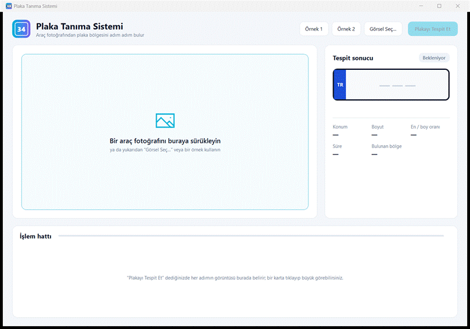
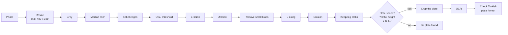
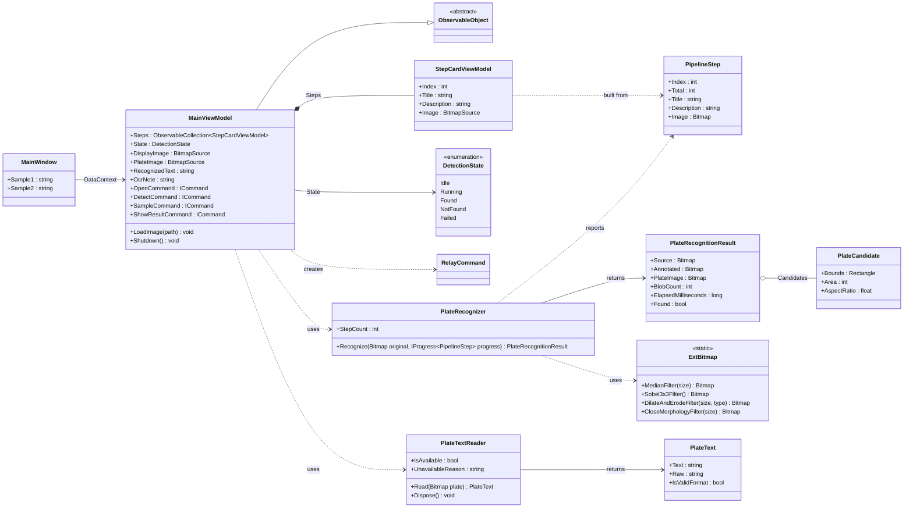
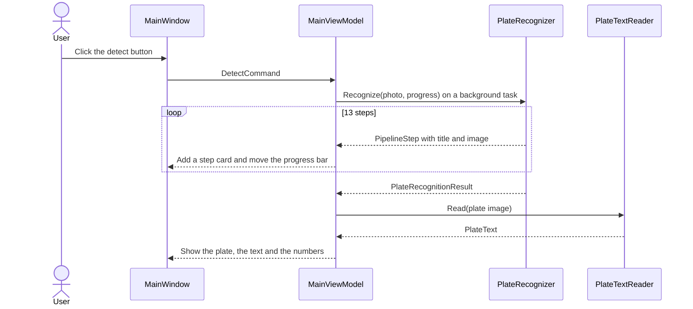

<p align="center">
  
</p>

<h1 align="center">Plate Recognition System</h1>

<p align="center">
  A Windows desktop app that finds the licence plate in a car photo and reads it.<br>
  You can watch every step of the image processing, one by one.
</p>

<p align="center">
  🇹🇷 <a href="README.tr.md">Türkçe README</a> ·
  📄 <a href="PlateRecognitionSystemReport.pdf">Project report (PDF)</a>
</p>



## What does it do?

1. You choose a photo of the front of a car (or drag it into the window).
2. The app cleans the picture and looks for a shape that looks like a plate.
3. It crops the plate and reads the letters and numbers (OCR).
4. It checks that the text matches a Turkish plate, for example `35 AF 8952`.

## Features

- **Step-by-step view.** 13 small cards show what the picture looks like after each step. Click a card to see it big.
- **Plate on the photo.** A green box shows where the plate is. The cropped plate and the text are shown next to it.
- **Numbers.** Position, size, shape ratio, time and number of regions found.
- **Clear messages.** Different colours for "plate found", "plate not found", "text looks wrong" and "error".
- **Drag and drop.** Or use the buttons: two sample photos are included.
- **Open from the command line.** `PlakaTanima.exe photo.jpg`

## Project structure

| Folder | What is inside |
|---|---|
| `PlakaTanimaSistemi/PlakaTanima.Wpf` | **The main app** (WPF). Start here. |
| `PlakaTanimaSistemi/PlakaTanima.Core` | The image processing and plate reading code. No window code. |
| `PlakaTanimaSistemi/legacy/LicensePlateRecognition` | The old WinForms app. Kept only as a reference. |
| `PlakaTanimaSistemi/references` | Libraries used by the project (AForge, Tesseract, Otsu). |
| `PlakaTanimaSistemi/images` | Sample photos. |
| `docs` | Pictures used in this README. |

## Getting started

You need Windows and Visual Studio with **.NET Framework 4.8** support.

1. Open `PlakaTanimaSistemi/PlakaTanima.sln`.
2. Make sure `PlakaTanima.Wpf` is the startup project (it is the default).
3. Press **F5**.

Or build it from a terminal:

```bash
dotnet build PlakaTanimaSistemi/PlakaTanima.sln --configuration Release
```

> The project is built for **x86 (32-bit)** because the Otsu and Tesseract libraries are 32-bit.

### Reading the text (OCR)

Finding the plate works without any extra files. To also **read** the text, the app needs one language file.
It is not stored in this repository because it is big.

1. Download [`tesseract-ocr-3.01.eng.tar.gz`](https://storage.googleapis.com/google-code-archive-downloads/v2/code.google.com/tesseract-ocr/tesseract-ocr-3.01.eng.tar.gz) (about 4 MB).
2. Take out only `eng.traineddata`:

   ```bash
   tar -xzf tesseract-ocr-3.01.eng.tar.gz tesseract-ocr/tessdata/eng.traineddata
   ```

3. Copy it to `PlakaTanimaSistemi/PlakaTanima.Wpf/tessdata/eng.traineddata`.
4. Build again.

**Important:** use version **3.01**. The OCR engine in this project is Tesseract 3.01. A newer language file (3.04 or later) makes it crash.
If the file is missing, the app still finds the plate and tells you that it cannot read the characters.
The OCR engine also needs the *Visual C++ 2008 runtime* on the computer.

## How it works



The [Turkish README](README.tr.md) explains each step with pictures and code.

## UML diagrams

### Class diagram



`PlakaTanima.Wpf` holds `MainWindow`, `MainViewModel`, `StepCardViewModel` and the helper classes.
`PlakaTanima.Core` holds the plate and OCR classes and has no window code, so it can be reused.

### Sequence diagram: finding a plate



## Releases and branch names

Every pull request that is merged into `master` makes a new release with a version like `v1.2.3`.
The version goes up by the **name of the branch**:

| Branch name contains | Label | Version change | Example |
|---|---|---|---|
| `major` | `breaking` | first number | `v1.2.3` → `v2.0.0` |
| `dev` | `enhancement` | second number | `v1.2.3` → `v1.3.0` |
| `hotfix` | `bug` | third number | `v1.2.3` → `v1.2.4` |
| none of these | none | third number | `v1.2.3` → `v1.2.4` |

The GitHub Actions in `.github/workflows` also build the project, add the label and assign the pull request to `NisanurBulut`.

## Good to know

- The app was made for photos of the **front** of a car, with a plate you can see clearly.
- The text reading was only tested on the two sample photos. Other photos may give wrong text.
  If the text does not look like a Turkish plate, the app shows it in yellow so you can check it.
- The old WinForms app in `legacy` finds the plate but does not read the text.

## Licence

GNU General Public License v3.0. See [`COPYING.txt`](PlakaTanimaSistemi/COPYING.txt).
